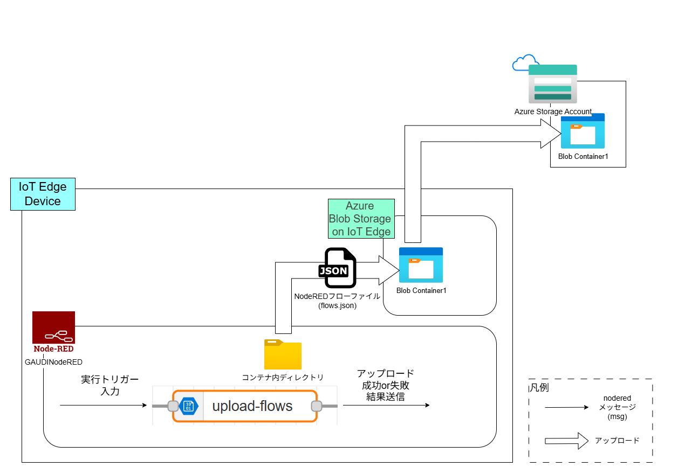
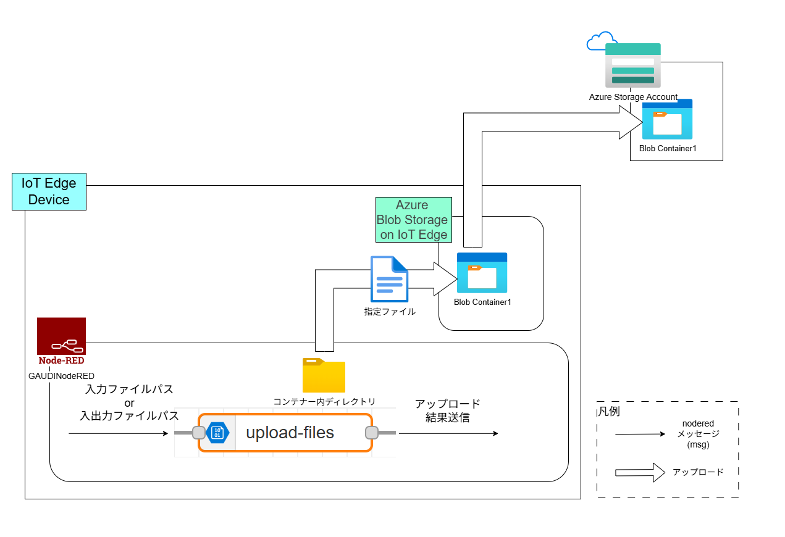
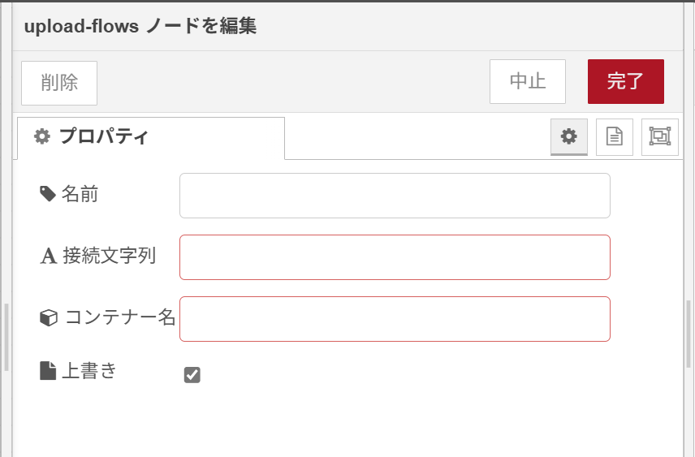
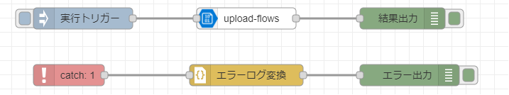
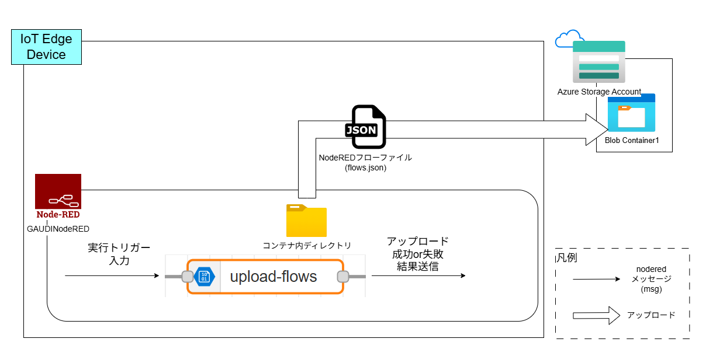
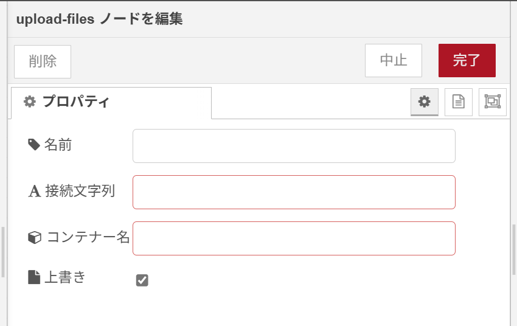
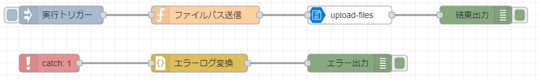
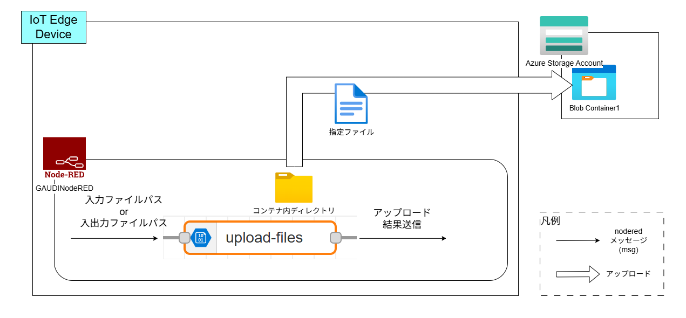

# node-red-blobstorage

## 目次

* [概要](#概要)
* [ノードの設定](#ノードの設定)
  * [環境変数](#環境変数)
  * [コンテナーの作成オプション Create Option](#コンテナーの作成オプション-create-option)
* [ノードライブラリの説明](#ノードライブラリの説明)
  * [upload-flows](#Node-Specification-upload-flows)
  * [upload-files](#Node-Specification-upload-files)
* [ログ出力内容](#ログ出力内容)
  * [upload-flows](#Log-upload-flows)
  * [upload-files](#Log-upload-files)
* [エラー時動作一覧](#エラー時動作一覧)
* [Feedback](#feedback)
* [LICENSE](#license)

## 概要

Azure Blob StorageにNodeREDのフローファイルか任意のファイルをアップロードする機能。  
Azure Blob Storage on IoT Edgeモジュールを通して使用することを推奨。※  

※ Azure Blob Storageに直接アップロードする場合、  
&emsp; ネットワークエラーが発生すると、ファイルがアップロードできない（再送処理されない）。  
&emsp; Azure Blob Storage on IoT Edgeにはアップロード管理機能があり、  
&emsp; ネットワークエラー等でアップロード失敗したファイルをローカルストレージに保管し、ネットワーク復旧時再送される。  

以下のノードを含む。

* upload-flows 現在のNodeREDフローのファイル(flows.json)をアップロードする。  
※Azure Blob Storage on IoT Edgeモジュールを介さず、クラウドに直接アップロードも可能  


* upload-files 入力メッセージに指定されているファイルをアップロードする。  
※Azure Blob Storage on IoT Edgeモジュールを介さず、クラウドに直接アップロードも可能  


## ノードの設定

### 環境変数

#### 環境変数の値

(なし)

### コンテナーの作成オプション Create Option

#### コンテナーの作成オプション Create Option の値

(なし)

## ノードライブラリの説明

<a id="Node-Specification-upload-flows"></a>

### upload-flows

#### 機能概要

  現在のNodeREDフローのファイル(flows.json)をAzure Blob Storageにアップロードする。  
  アップロード後のblob上のパスは、flows.jsonとなる。

#### プロパティ

  

 | プロパティ   | Type     | Required | Conditions | Default      | Description                                                                                                                  |
 | ------------ | -------- | -------- | ---------- | ------------ | ---------------------------------------------------------------------------------------------------------------------------- |
 | 名前         | textbox  |          |            |              | ノードの表示名を設定。                                                                                                       |
 | 接続文字列   | textbox  | 〇       |            |              | ストレージアカウントもしくはAzure Blob Storage on IoT Edgeモジュールの接続文字列。                                           |
 | コンテナー名 | textbox  | 〇       |            |              | アップロード先blobコンテナー名。                                                                                             |
 | 上書き       | checkbox |          |            | チェックあり | 同名ファイルがblobに既存だった場合、上書きするかどうか。<br>チェックあり：上書きする<br>チェックなし：上書きしない(例外出力) |

#### 入力メッセージ

なし(実行トリガーとしてのみ利用される)

#### 出力メッセージ

アップロード結果通知

| JSON Key             | Type         | Description                                                                                   |
| -------------------- | ------------ | --------------------------------------------------------------------------------------------- |
| payload              | string       | アップロード結果。<br>"Upload process succeeded."：成功。<br>"Upload process failed."：失敗。 |
| inputMessage         | object       | 入力メッセージ。                                                                              |
| succeededPaths       | object       | アップロード成功した入出力ファイルパスリスト。                                                |
| &emsp; inputPathList | string array | アップロード成功した入力ファイルパスリスト。blobPathListの同インデックス値とセットになる。    |
| &emsp; blobPathList  | string array | アップロード成功した出力ファイルパスリスト。inputPathListの同インデックス値とセットになる。   |

##### 出力メッセージ例

```json
{
  "_msgid": "メッセージid",
  "payload": "Upload process succeeded.",
  "inputMessage": 入力メッセージ,
  "succeededPaths": {
    "inputPathList":["/data/flows.json"],
    "blobPathList":["flows.json"]
    }
}
```

#### 例外メッセージ

例外発生時に出力されるメッセージ。catchノードで取得可能で、  
catchノードが存在しない場合はエラー情報メッセージのみがerrorレベルログとして出力される。

| JSON Key             | Type         | Description                                                                                      |
| -------------------- | ------------ | ------------------------------------------------------------------------------------------------ |
| payload              | string       | 入力メッセージpayload。入力メッセージ次第で存在しない場合もある。                                |
| failedPaths          | object       | アップロード失敗した入出力ファイルパスリスト。アップロード時以外で発生した例外の場合存在しない。 |
| &emsp; inputPathList | string array | アップロード失敗した入力ファイルパスリスト。blobPathListの同インデックス値とセットになる。       |
| &emsp; blobPathList  | string array | アップロード失敗した出力ファイルパスリスト。inputPathListの同インデックス値とセットになる。      |
| error                | object       | エラー情報                                                                                       |

#### 使用例1(Azure Blob Storage on IoT Edgeモジュールを経由してアップロードする場合) **(推奨)**

　[フロー構成]

  

  [モジュール構成]

  

  [プロパティ]

  | プロパティ   | Value                                                                                                                                                                                                                                                                                                                      |
  | ------------ | -------------------------------------------------------------------------------------------------------------------------------------------------------------------------------------------------------------------------------------------------------------------------------------------------------------------------- |
  | 接続文字列   | Azure Blob Storage on IoT Edgeモジュールの接続文字列<br>DefaultEndpointsProtocol=https;BlobEndpoint=http://<コンテナー名>:<モジュールPort番号>/<モジュール環境変数LOCAL_STORAGE_ACCOUNT_NAME>;<br>AccountName=<モジュール環境変数LOCAL_STORAGE_ACCOUNT_NAME>;<br>AccountKey=<モジュール環境変数LOCAL_STORAGE_ACCOUNT_KEY>; |
  | コンテナー名 | container1                                                                                                                                                                                                                                                                                                                 |
  | 上書き       | チェックを入れる                                                                                                                                                                                                                                                                                                           |

  [入力メッセージ]

  なし

  [出力メッセージ]

  アップロード成功時

  ```json
  {
    "_msgid": "メッセージid",
    "payload": "Upload process succeeded.",
    "inputMessage": 入力メッセージ,
    "succeededPaths": {
      "inputPathList":["/data/flows.json"],
      "blobPathList":["flows.json"]
      }
  }
  ```

  アップロード失敗時
  
  ```json
  {
    "_msgid": "メッセージid",
    "payload": "Upload process failed.",
    "inputMessage": 入力メッセージ,
    "succeededPaths": {
      "inputPathList": [],
      "blobPathList": []
    }
  }
  ```

  [catchノードでキャッチできるアップロード失敗メッセージ]
  アップロード失敗時

  ```json
  {
    "_msgid": "メッセージid",
    "payload": 入力メッセージ,
    "failedPaths": {
      "inputPathList": ["/data/flows.json"],
      "blobPathList": ["flows.json"]
    },
    "error": エラー情報
  }
  ```

#### 使用例2(Azure Blob Storageに直接アップロードする場合)

  [フロー構成]

  使用例1と同様。

  [モジュール構成]

  

  [プロパティ]

  | プロパティ   | Value                            |
  | ------------ | -------------------------------- |
  | 接続文字列   | ストレージアカウントの接続文字列 |
  | コンテナー名 | container1                       |
  | 上書き       | チェックを入れる                 |

  [入力メッセージ]

  なし

  [出力メッセージ]

  使用例1と同様。

  [catchノードでキャッチできるアップロード失敗メッセージ]

  使用例1と同様

<a id="Node-Specification-upload-files"></a>

### upload-files

#### 機能概要

  入力メッセージに指定されているファイルをAzure Blob Storageにアップロードする。  
  途中でアップロードに失敗した場合でも、入力メッセージに指定されているすべてのファイルアップロード処理は実行される。  
  アップロード後のblob上のパスを入力メッセージで指定可能で、  
  入力メッセージで指定しない場合は{親ディレクトリ名(※)}/{ファイル名}となる。  

  ※ 入力メッセージに指定されている入力ファイルの親ディレクトリ名(ファイルの1階層上のみ)  
  例) 入力パス：/parent1/parent2/file.txt  
  　　アップロード後パス：parent2/file.txt

#### プロパティ

  

 | プロパティ   | Type     | Required | Conditions | Default      | Description                                                                                                                  |
 | ------------ | -------- | -------- | ---------- | ------------ | ---------------------------------------------------------------------------------------------------------------------------- |
 | 名前         | textbox  |          |            |              | ノードの表示名を設定。                                                                                                       |
 | 接続文字列   | textbox  | 〇       |            |              | ストレージアカウントもしくはAzure Blob Storage on IoT Edgeモジュールの接続文字列。                                           |
 | コンテナー名 | textbox  | 〇       |            |              | アップロード先blobコンテナー名。                                                                                             |
 | 上書き       | checkbox |          |            | チェックあり | 同名ファイルがblobに既存だった場合、上書きするかどうか。<br>チェックあり：上書きする<br>チェックなし：上書きしない(例外出力) |

#### 入力メッセージ

入力ファイルパスと出力blobパスを指定する場合 **(推奨)**

| JSON Key             | Type         | Description                                                                                                                                       |
| -------------------- | ------------ | ------------------------------------------------------------------------------------------------------------------------------------------------- |
| payload              | string       | アップロード対象の入出力ファイルパスリスト。                                                                                                      |
| &emsp; inputPathList | string array | アップロード対象の入力ファイルパスリスト。blobPathListの同インデックス値とセットになる。                                                          |
| &emsp; blobPathList  | string array | アップロード対象の出力ファイルパスリスト。パスの頭にスラッシュが付与されている場合例外が発生する。inputPathListの同インデックス値とセットになる。 |

入力ファイルパスのみを指定する場合

| JSON Key | Type         | Description                                |
| -------- | ------------ | ------------------------------------------ |
| payload  | string array | アップロード対象の入力ファイルパスリスト。 |

##### 入力メッセージ例

入力ファイルパスと出力blobパスを指定する場合 **(推奨)**

```json
{
  "payload": {
    "inputPathList": ["/data/fileNodeTest.log","/test.txt"],
    "blobPathList": ["NodeTest.log","data/test.txt"]
  }
}
```

入力ファイルパスのみを指定する場合

```json
{
  "payload": ["/data/fileNodeTest.log"]
}
```

#### 出力メッセージ

アップロード結果通知

| JSON Key             | Type         | Description                                                                                                                                            |
| -------------------- | ------------ | ------------------------------------------------------------------------------------------------------------------------------------------------------ |
| payload              | string       | アップロード結果。<br>"Upload process succeeded."：成功。<br>"Upload process failed."：失敗。<br>1件でもアップロード失敗があった場合は失敗扱いとなる。 |
| inputMessage         | object       | 入力メッセージ。                                                                                                                                       |
| succeededPaths       | object       | アップロード成功した入出力ファイルパスリスト。                                                                                                         |
| &emsp; inputPathList | string array | アップロード成功した入力ファイルパスリスト。blobPathListの同インデックス値とセットになる。                                                             |
| &emsp; blobPathList  | string array | アップロード成功した出力ファイルパスリスト。inputPathListの同インデックス値とセットになる。                                                            |

##### 出力メッセージ例

```json
  {
    "_msgid": "メッセージid",
    "payload": "Upload process succeeded.",
    "inputMessage": 入力メッセージ,
    "succeededPaths": {
      "inputPathList": ["/data/fileNodeTest.log","/test.txt"],
      "blobPathList": ["NodeTest.log","data/test.txt"]
    }
  }
  ```

#### 例外メッセージ

例外発生時に出力されるメッセージ。catchノードで取得可能で、  
catchノードが存在しない場合はエラー情報メッセージのみがerrorレベルログとして出力される。

| JSON Key             | Type         | Description                                                                                |
| -------------------- | ------------ | ------------------------------------------------------------------------------------------ |
| payload              | string       | 入力メッセージpayload。入力メッセージ次第で存在しない場合もある。                          |
| failedPaths          | object       | アップロード失敗した入出力ファイルパス。アップロード時以外で発生した例外の場合存在しない。 |
| &emsp; inputPathList | string array | アップロード失敗した入力ファイルパス。blobPathListの同インデックス値とセットになる。       |
| &emsp; blobPathList  | string array | アップロード失敗した出力ファイルパス。inputPathListの同インデックス値とセットになる。      |
| error                | object       | エラー情報                                                                                 |

#### 使用例1(Azure Blob Storage on IoT Edgeモジュールを経由してアップロードする場合かつ出力blobパスを指定する) **(推奨)**

  [フロー構成]

  

  [モジュール構成]

  

  [プロパティ]

  | プロパティ   | Value                                                                                                                                                                                                                                                                                                                  |
  | ------------ | ---------------------------------------------------------------------------------------------------------------------------------------------------------------------------------------------------------------------------------------------------------------------------------------------------------------------- |
  | 接続文字列   | Azure Blob Storage on IoT Edgeモジュールの接続文字列<br>DefaultEndpointsProtocol=https;BlobEndpoint=http://<コンテナー名>:<モジュールPort番号>/<モジュール環境変数LOCAL_STORAGE_ACCOUNT_NAME>;<br>AccountName=<モジュール環境変数LOCAL_STORAGE_ACCOUNT_NAME>;AccountKey=<モジュール環境変数LOCAL_STORAGE_ACCOUNT_KEY>; |
  | コンテナー名 | container1                                                                                                                                                                                                                                                                                                             |
  | 上書き       | チェックを入れる                                                                                                                                                                                                                                                                                                       |

  [入力メッセージ]

  ```json
  {
    "payload": {
      "inputPathList": ["/data/fileNodeTest.log","/test.txt"],
      "blobPathList": ["NodeTest.log","data/test.txt"]
    }
  }
  ```

  [出力メッセージ]

  アップロードが全件成功時

  ```json
  {
    "_msgid": "メッセージid",
    "payload": "Upload process succeeded.",
    "inputMessage": 入力メッセージ,
    "succeededPaths": {
      "inputPathList": ["/data/fileNodeTest.log","/test.txt"],
      "blobPathList": ["NodeTest.log","data/test.txt"]
    }
  }
  ```

  アップロードが1件以上失敗時(1つ目のファイルアップロード失敗時)  
  ※succeededPathsのinputPathListとblobPathListには成功したファイル名が入る

  ```json
  {
    "_msgid":"メッセージid",
    "payload":"Upload process failed.",
    "inputMessage": 入力メッセージ,
    "succeededPaths": {
      "inputPathList": ["/test.txt"],
      "blobPathList": ["data/test.txt"]
    }
  }
  ```

  [catchノードでキャッチできるアップロード失敗メッセージ]  
  アップロードが1件以上失敗時(1つ目のファイルアップロード失敗時)

  ```json
  {
    "_msgid": "メッセージid",
    "payload": 入力メッセージ,
    "failedPaths": {
      "inputPathList": ["/data/fileNodeTest.log"],
      "blobPathList": ["NodeTest.log"]
    },
    "error": {
      "message":"["エラーメッセージ1 path:/data/fileNodeTest.log","エラーメッセージ2 path:NodeTest.log"]"
    }
  }
  ```

#### 使用例2(Azure Blob Storageに直接アップロードかつ出力blobパスを指定しない)

  [フロー構成]
  使用例1と同様。

  [モジュール構成]

  

  [プロパティ]

 | プロパティ   | Value                            |
 | ------------ | -------------------------------- |
 | 接続文字列   | ストレージアカウントの接続文字列 |
 | コンテナー名 | container1                       |
 | 上書き       | チェックを入れる                 |

  [入力メッセージ]

  ```json
  {
    "payload": ["/data/fileNodeTest.log, /data/fileNodeTest.txt"]
  }
  ```

  [出力メッセージ]

  アップロードが全件成功時

  ```json
  {
    "_msgid": "メッセージid",
    "payload": "Upload process succeeded.",
    "inputMessage": 入力メッセージ,
    "succeededPaths": {
      "inputPathList": ["/data/fileNodeTest.log", "/data/fileNodeTest.txt"],
      "blobPathList": ["data/fileNodeTest.log", "data/fileNodeTest.txt"]
    }
  }
  ```

  アップロードが1件以上失敗時(1つ目のファイルアップロード失敗時)  
  ※succeededPathsのinputPathListとblobPathListには成功したファイル名が入る

  ```json
  {
    "_msgid":"メッセージid",
    "payload":"Upload process failed.",
    "inputMessage": 入力メッセージ,
    "succeededPaths": {
      "inputPathList": ["/data/fileNodeTest.txt"],
      "blobPathList": ["data/fileNodeTest.txt",]
    }
  }
  ```

  [catchノードでキャッチできるアップロード失敗メッセージ]  
  アップロードが1件以上失敗時(1つ目のファイルアップロード失敗時)

  ```json
  {
    "_msgid": "メッセージid",
    "payload": 入力メッセージ,
    "failedPaths": {
      "inputPathList": ["/data/fileNodeTest.log"],
      "blobPathList": ["data/fileNodeTest.log"]
    },
    "error": {
      "message":"["エラーメッセージ1 data/fileNodeTest.log"]"
    }
  }
  ```

## ログ出力内容

errorレベルログは、catchノードが存在する場合はそちらにメッセージとして出力され、ログには出力されない。  
(ログには同じ出力概要のinfoレベルログのみ出力される。)

<a id="Log-upload-flows"></a>

### upload-flows

| LogLevel | 出力概要                                                         |
| -------- | ---------------------------------------------------------------- |
| error※1  | クライアント取得失敗<br>アップロード失敗                         |
| warn     | 無し                                                             |
| info     | アップロード成功<br>クライアント取得失敗※2<br>アップロード失敗※2 |
| debug    | 無し                                                             |
| trace    | 無し                                                             |

※1 catchノードが存在する場合、ログ出力されない<br>
※2 catchノードが存在する場合でもログ出力される

<a id="Log-upload-files"></a>

### upload-files

| LogLevel | 出力概要                                                                                         |
| -------- | ------------------------------------------------------------------------------------------------ |
| error※1  | クライアント取得失敗<br>入力メッセージの構成が不正<br>アップロード失敗                           |
| warn     | 無し                                                                                             |
| info     | アップロード成功<br>クライアント取得失敗※2<br>入力メッセージの構成が不正※2<br>アップロード失敗※2 |
| debug    | 無し                                                                                             |
| trace    | 無し                                                                                             |

※1 catchノードが存在する場合、ログ出力されない<br>
※2 catchノードが存在する場合でもログ出力される

## エラー時動作一覧

| 分類                       | エラー内容                                                                                       | 動作                                                   | 出力ログレベル |
| -------------------------- | ------------------------------------------------------------------------------------------------ | ------------------------------------------------------ | -------------- |
| **ノードのプロパティ設定** | 必須項目未設定                                                                                   | デプロイ時エディター上に警告が出る。                   | -              |
| &emsp;                     | 接続文字列のストレージアカウントもしくは<br>Azure Blob Storage on IoT Edgeモジュールの接続に失敗 | デプロイ時エラーになる。                               | error          |
| **メッセージ入力**         | 入力メッセージの構成が不正                                                                       | 例外出力。<br>ノード処理は中断する。                   | error          |
| &emsp;                     | ファイルアップロードに失敗                                                                       | 例外出力。<br>アップロード失敗のメッセージを出力する。 | error          |
| &emsp;                     | 上書きのチェックを入れないかつ<br>同名ファイルがアップロード先に存在                             | 例外出力。<br>アップロード失敗のメッセージを出力する。 | error          |

※ 出力した例外は、catchノードで受信可能。

## Feedback

お気づきの点があれば、ぜひIssueにてお知らせください。

## LICENSE

node-red-blobstorage is licensed under the MIT License, see the [LICENSE](LICENSE) file for details.
